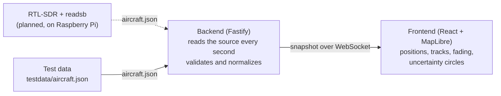

# adsb-pipeline

A live aircraft map built from ADS-B data. A self-initiated project to learn the whole chain, from a passive radio receiver to an operator view in the browser.

readsb handles the signal processing. I built the rest: reading and validating the data, a real-time backend, and a map that is honest about how old each position is.


`TypeScript` `Node.js` `Fastify` `WebSocket` `React` `Vite` `MapLibre GL JS`

## How it works



1. The backend reads readsb's `aircraft.json` every second, from a file or over HTTP.
2. Each aircraft is validated and normalized into a typed `Observation`. Aircraft without a position are dropped.
3. The latest observation per aircraft is kept in memory and sent to every connected browser as a snapshot.
4. The frontend draws positions, tracks and uncertainty circles, and updates the age of every position once a second, even when no new data arrives.

## Design decisions

- **Validate at the boundary.** Everything from outside is `unknown` until it has been checked. Unknown values stay `null` instead of becoming 0, because an altitude of 0 is a real value and "unknown" is not.
- **Two clocks, kept apart.** Each observation carries both the sensor time (readsb's clock) and the receive time (the backend's clock). In the browser, position age is measured on the browser's own clock, so the map never compares clocks across machines.
- **Stale data never looks fresh.** Markers fade from orange to grey over 60 seconds. An uncertainty circle grows with ground speed × age, showing how far the aircraft could have moved. When speed is unknown, it assumes 600 knots: better too large a circle than none.
- **One bad read doesn't take the system down.** A failed read is logged and retried a second later. New clients get the current picture immediately. If the connection drops, the frontend reconnects with exponential backoff (1 s up to 10 s) and keeps showing the last known data.
- **Tracks without duplicates.** Each aircraft keeps up to 120 track points, and a point is only added when the sensor time has changed.

## Running it locally

Requires Node.js 22 or newer. The map tiles come from OpenFreeMap, so the frontend needs internet access.

**Backend**

```bash
cd backend
npm install
npm run dev
```

The backend listens on port 3000 and reads `testdata/aircraft.json` by default.

| Endpoint | What it does |
| --- | --- |
| `GET /health` | `{ ok: true, aircraft: <count> }` |
| `GET /ws` | WebSocket that sends a snapshot of all aircraft every second |

| Environment variable | Default | Meaning |
| --- | --- | --- |
| `AIRCRAFT_SOURCE` | `testdata/aircraft.json` | File path or `http(s)://` URL to readsb's `aircraft.json` |
| `NODE_ID` | `dev-pc` | Name of the receiver, included in every observation |
| `PORT` | `3000` | Port for HTTP and WebSocket |

**Frontend**

```bash
cd frontend
npm install
npm run dev
```

Open the address Vite prints (usually http://localhost:5173). The frontend connects to `ws://localhost:3000/ws`.

## Project structure

```
backend/
  src/index.ts       Fastify server, polling loop and WebSocket broadcast
  src/source.ts      Reads aircraft.json from a file or over HTTP
  src/normalize.ts   Validation and normalization into Observation
  src/types.ts       The Observation type
  testdata/          Sample aircraft.json
frontend/
  src/useAircraft.ts WebSocket connection with reconnect and backoff
  src/tracks.ts      Track history per aircraft
  src/geo.ts         Uncertainty radius and circle geometry
  src/mapData.ts     Converts observations to GeoJSON
  src/AircraftMap.tsx MapLibre map and layers
```

## Status and next steps

Works end to end with test data.

- [ ] Live reception with an RTL-SDR dongle and readsb on a Raspberry Pi. The backend can already read `aircraft.json` over HTTP.
- [ ] A shared data contract with Protobuf, replacing the type file that is copied between backend and frontend today.
